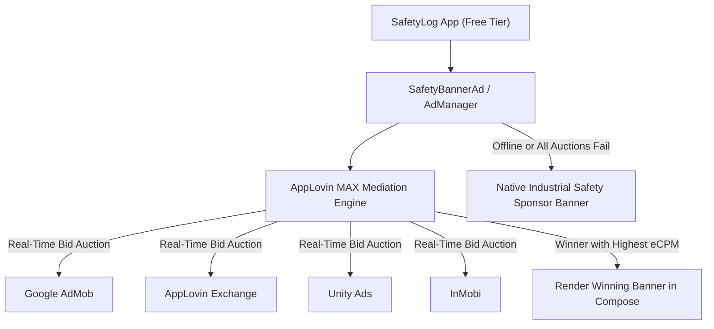

# Alternative Ad Network Integration & Mediation Plan

## 1. Executive Summary

This document outlines the architectural plan for integrating non-Google ad networks into **SafetyLog: Fire & Safety Audit** (`com.safetylog.inspection.app`).

### Goals:
1. **Revenue Maximization**: Introduce real-time automated bidding auctions where multiple ad networks compete simultaneously for each banner impression, driving up effective cost per mille (eCPM).
2. **Fill-Rate Redundancy**: Ensure that if one network has no available inventory or encounters network latency, another network immediately fills the slot.
3. **Strict UX Protection**: Maintain SafetyLog's professional utility design—**strictly non-intrusive bottom banner ads only**, zero full-screen popups, and immediate permanent dismissal for paid users (`Ad-Free`, `Pro`, and `Enterprise`).

---

## 2. Recommended Mediation Strategy: AppLovin MAX

Rather than hardcoding a single alternative ad network, the industry standard is to use **AppLovin MAX Mediation**.



### Why AppLovin MAX?
* **Real-time In-App Bidding**: AdMob, AppLovin, Unity Ads, and InMobi bid simultaneously; the highest paying ad is displayed.
* **Unified Payouts**: You receive consolidated monthly payouts rather than managing separate payment thresholds across four different dashboards.
* **Lightweight Android SDK**: Optimized for modern Android versions (API 26–36) with full Jetpack Compose compatibility.

---

## 3. Network Comparison

| Feature | Google AdMob (Current) | AppLovin MAX (Planned) | Unity Ads (Standalone) |
| :--- | :--- | :--- | :--- |
| **Bidding Auction** | Google network only (unless mediated) | Multi-network unified auction | Single network |
| **Average Banner eCPM** | $0.40 – $1.20 | **$0.90 – $2.50** | $0.50 – $1.50 |
| **Fill Rate** | 85% – 95% | **99.5% – 100%** | 80% – 90% |
| **Approval Friction** | Strict site/app verification | Streamlined developer onboarding | Fast & simple |
| **Payout Methods** | Direct Deposit (EFT) | ACH, Wire, PayPal | ACH, Wire, PayPal |

---

## 4. Software Architecture Plan

### 4.1. Clean Provider Abstraction (`AdProvider.kt`)

Currently, `SafetyBannerAd.kt` calls Google's `AdView` directly. When implementing this plan, we will introduce a clean interface to decouple the UI from any specific ad SDK:

```kotlin
interface BannerAdProvider {
    val providerName: String
    fun initialize(context: Context)
    @Composable
    fun RenderBanner(
        modifier: Modifier,
        onAdLoaded: () -> Unit,
        onAdFailed: (String) -> Unit
    )
}
```

### 4.2. Concrete Providers

1. **`GoogleAdMobProvider`**: Wraps the existing Google `AdView`.
2. **`AppLovinMaxProvider`**: Wraps AppLovin's `MaxAdView`.
3. **`UnityAdsProvider`**: Wraps Unity's `BannerView`.

### 4.3. Compose Container (`SafetyBannerAd.kt`)

The UI component remains identical in layout and styling:
* Respects `isAdFree` flag (Ad-Free $2.99, Pro $0.99/mo, Enterprise $2.50/mo users see 0 ads).
* If the primary provider fails to fill, it cascades to the secondary provider.
* If all fail or device is offline, it gracefully renders the built-in industrial sponsor tile.

---

## 5. Step-by-Step Implementation Checklist (When Ready)

### Phase 1: Dashboard Accounts
- [ ] Create an **AppLovin** developer account at [dash.applovin.com](https://dash.applovin.com/).
- [ ] Add application `com.safetylog.inspection.app`.
- [ ] Create a **Banner Ad Unit** (`320x50` / Adaptive Banner).
- [ ] (Optional) Link Google AdMob and Unity Ads adapters inside the MAX mediation dashboard.

### Phase 2: Gradle & ProGuard Setup
- [ ] Add AppLovin Maven repository in `settings.gradle.kts`:
  ```kotlin
  maven { url = uri("https://artifacts.applovin.com/android") }
  ```
- [ ] Add dependencies in `app/build.gradle.kts`:
  ```kotlin
  implementation("com.applovin:applovin-sdk:13.1.0")
  implementation("com.applovin.mediation:google-adapter:23.3.0.0") // AdMob mediation adapter
  ```
- [ ] Add SDK App Key to `AndroidManifest.xml`:
  ```xml
  <meta-data
      android:name="applovin.sdk.key"
      android:value="YOUR_APPLOVIN_SDK_KEY" />
  ```
- [ ] Add AppLovin keep rules to `app/proguard-rules.pro`.

### Phase 3: Code Implementation
- [ ] Implement `AppLovinMaxBannerView` composable inside `app/src/main/java/com/safetylog/app/ui/components/`.
- [ ] Initialize the SDK asynchronously in `MainActivity.kt` during application startup.
- [ ] Test banner rendering on physical devices and emulators.

### Phase 4: Google Play Compliance
- [ ] Update **Data Safety** questionnaire in Google Play Console if new network identifiers are collected.
- [ ] Update **Privacy Policy** (`https://kyouk56.github.io/inspectfield-safetylog/`) to disclose AppLovin as a third-party ad provider.

---

## 6. Safety & Compliance Rules

1. **No Interstitials/Full-Screen Ads**: Never introduce full-screen takeovers or timer popups. Safety inspectors work in active field environments (electrical rooms, boiler areas); interrupting an emergency audit with an unclosable video ad violates commercial user expectations.
2. **Honor Ad-Free Entitlement**: The billing repository state (`isAdFree`, `effectiveTier`) must always take strict precedence. If a receipt exists for lifetime ad removal or an active subscription, all ad networks must be destroyed and disconnected.
